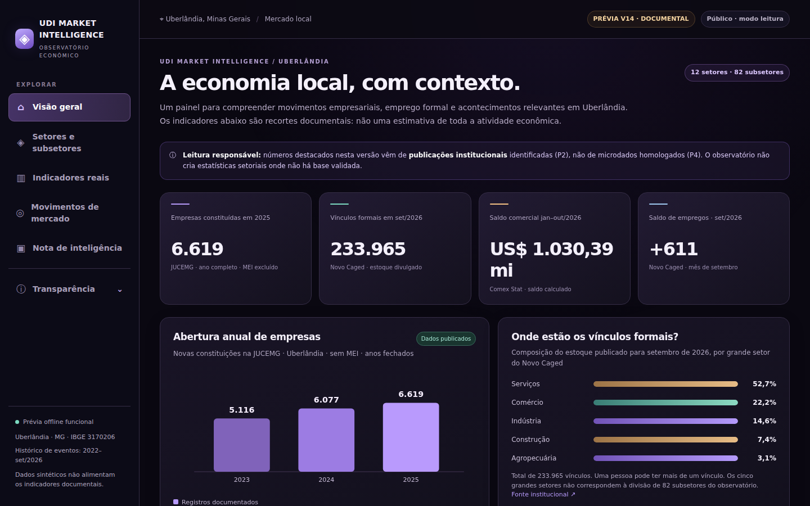
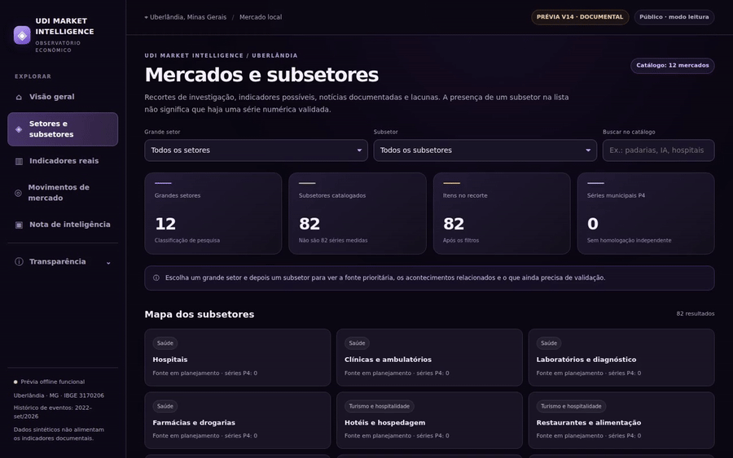
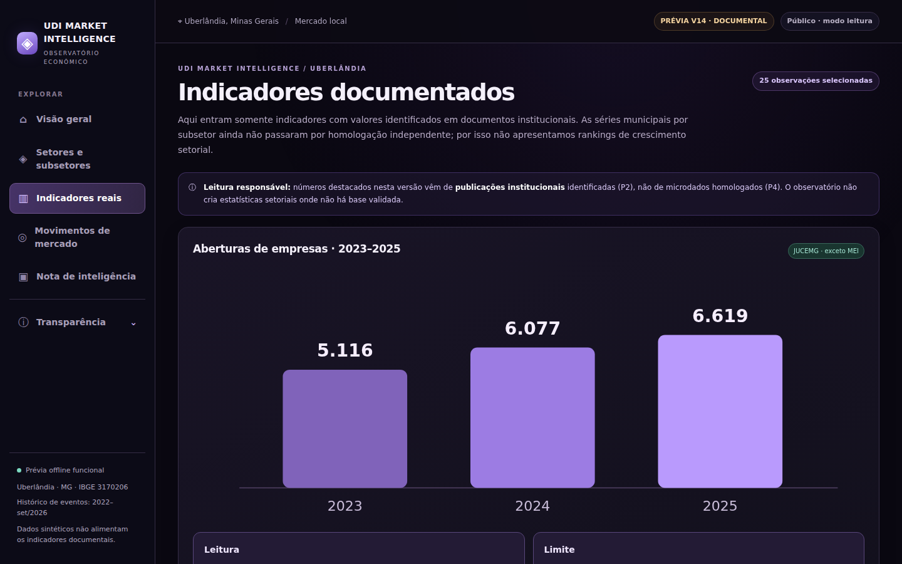
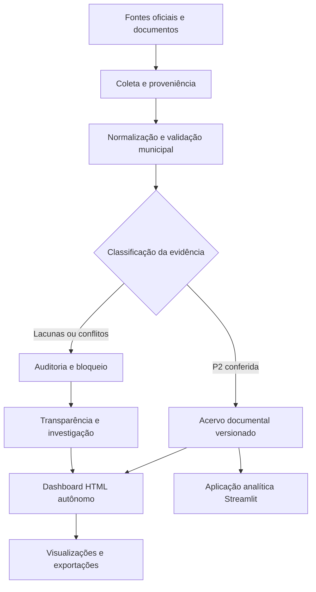
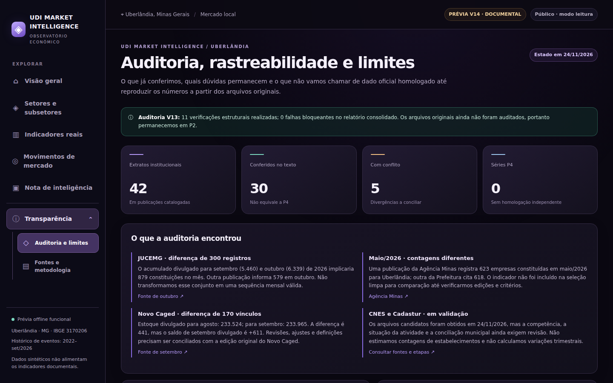

# UDI Market Intelligence

**Observatório Econômico de Uberlândia, Minas Gerais**

Market Intelligence · Data Science · Business Analytics · Data Governance

**Beta 1.0 documental | Projeto independente**

[**Explorar o dashboard**](docs/index.html) · [Assistir à demonstração](assets/videos/demonstracao-udi-beta.mp4) · [Metodologia](docs/metodologia.md) · [Arquitetura](docs/arquitetura.md)

| Mercados catalogados | Subsetores mapeados | Indicadores documentais (P2) | Acontecimentos documentados |
| :---: | :---: | :---: | :---: |
| **12** | **82** | **25** | **38** |

> **Edição de avaliação — 24/11/2026.** Acervo documental, não uma série estatística completa ou monitoramento em tempo real. Os 82 subsetores constituem uma taxonomia de investigação, não 82 séries quantitativas validadas. Não há séries P4 homologadas.

## Acesse o dashboard interativo

### [**Baixar e explorar o painel — Beta 1.0**](docs/index.html)

1. Abra o link acima.
2. Clique em **Download raw file** (ícone de download no canto superior direito da visualização do arquivo).
3. Abra o arquivo `index.html` no Chrome ou Edge.

O painel é um HTML autônomo: funciona offline, sem instalações, servidor ou dependências externas para navegar. O GitHub mostra o código do arquivo HTML; o download é necessário para executar a interface. Os links das fontes institucionais exigem internet.

### Demonstração real

GIF de demonstração — clique para ocultar ou exibir

[Alternativa textual à demonstração e ao vídeo](assets/videos/README.md). Feche a seção do GIF para ocultar o movimento.

[**Vídeo demonstrativo completo (75 segundos)**](assets/videos/demonstracao-udi-beta.mp4) · [Galeria de capturas desktop e mobile](assets/screenshots/README.md)

## O problema de negócio

Informações sobre a economia municipal estão dispersas entre bases governamentais, boletins, publicações institucionais e notícias de mercado. Reunir essas evidências não é suficiente: competências, universos, unidades e níveis de confiabilidade nem sempre são comparáveis.

O UDI Market Intelligence foi concebido para organizar esse cenário em uma interface analítica, com proveniência e ressalvas explícitas. A proposta é reduzir o esforço de pesquisa, orientar perguntas de negócio e permitir que cada leitura seja confrontada com sua fonte original.

| Dimensão | Aplicação proposta |
|---|---|
| Inteligência de mercado | Investigar segmentos, movimentos empresariais e fontes de informação |
| Estratégia e negócios | Contextualizar decisões de expansão e estudos de mercado |
| Gestão pública e pesquisa | Consultar indicadores municipais e identificar lacunas de evidência |
| Governança de dados | Distinguir fatos documentados, intenções, aproximações e séries homologadas |

Esses são casos de uso propostos; não representam resultados de adoção comercial ou validação de clientes.

## Explore as funcionalidades

| Área | O que é possível consultar |
|---|---|
| Visão geral | Indicadores econômicos, gráficos e leituras contextualizadas |
| Mercados e subsetores | Filtros por mercado e segmento; fontes candidatas |
| Indicadores documentados | Valores, competências, unidades, fontes e ressalvas |
| Movimentos de mercado | Acontecimentos, anúncios e iniciativas, com busca e filtros |
| Auditoria e limites | Divergências, lacunas e critérios de exclusão |
| Fontes e metodologia | Catálogo de fontes e níveis de evidência |
| Nota de inteligência | Relatórios exploratórios por mercado e exportações |

## Evidências e leituras econômicas

| Indicador | Resultado | Interpretação e limite |
|---|---:|---|
| Constituições de empresas em 2025 | **6.619** | JUCEMG, ano completo, sem MEI; não equivale a empresas ativas |
| Estoque de vínculos formais, set/2026 | **233.965** | Vínculos, não necessariamente pessoas distintas |
| Saldo de emprego formal, set/2026 | **+611** | Admissões menos desligamentos; não confundir com variação do estoque |
| Exportações, jan–out/2026 | **US$ 1,214 bi** | Agregado Comex Stat por domicílio fiscal |
| Importações, jan–out/2026 | **US$ 183,3 mi** | Agregado Comex Stat no mesmo recorte |
| Saldo comercial, jan–out/2026 | **US$ 1,030 bi** | Diferença calculada em dólares inteiros |

**Leitura analítica:** as constituições anuais sem MEI passaram de 5.116 em 2023 para 6.077 em 2024 e 6.619 em 2025. A expansão entre 2024 e 2025 foi de aproximadamente 8,9%. Em setembro de 2026, serviços concentravam aproximadamente 52,7% dos vínculos formais divulgados. São evidências de universos distintos, não provas de relação causal ou crescimento de todos os subsetores.

Fontes: [JUCEMG/Agência Minas](https://www.agenciaminas.mg.gov.br/noticia/minas-gerais-teve-mais-de-114-mil-novas-empresas-abertas-em-2025-128761), [CEPES/IERI/UFU — setembro de 2026](https://www.ieri.ufu.br/acontece/2026-11-boletim-mensal-do-emprego-de-uberlandia-setembro-de-2026), [Comex Stat/MDIC — município](https://comexstat.mdic.gov.br/pt/municipio) (consulta à API em 24/11/2026). A [documentação de resultados](docs/resultados.md) apresenta os valores completos, períodos e outras fontes. Comércio exterior refere-se ao domicílio fiscal do declarante, não necessariamente ao local de produção.

## Arquitetura e competências técnicas

| Camada | Tecnologias utilizadas |
|---|---|
| Processamento e validação | Python, pandas, NumPy, CSV, SQLite |
| Aplicação analítica | Streamlit, Plotly |
| Interface | HTML, CSS, JavaScript, SVG |
| Qualidade | unittest, Node.js, Playwright, GitHub Actions |
| Rastreabilidade | Git, registros documentais, SHA-256 |

Este repositório reúne a interface de demonstração e a documentação. As rotinas de processamento e as bases brutas não integram esta edição. O front-end e o acervo documental incorporado podem ser inspecionados por quem recebe o HTML.

## Governança e metodologia

Cada observação registra município, competência, indicador, unidade, universo, fonte e ressalva. O observatório conserva divergências em vez de estimar resultados desconhecidos.

| Nível | Evidência |
|---|---|
| P0 | Simulação restrita ao desenvolvimento; não representa a economia real |
| P1 | Fonte ou recurso identificado |
| P2 | Valor conferido em publicação institucional ou agregado oficial consultado |
| P3 | Arquivo primário obtido, hash registrado e processamento reproduzível |
| P4 | Série reconciliada, comparável e revisada independentemente |

**25 observações P2, 29 extratos históricos selecionados, 7 alertas e nenhuma série P4 homologada.** O histórico de acontecimentos abrange 2022 a setembro de 2026, com atualizações qualitativas posteriores. Emprego até setembro e comércio exterior até outubro de 2026.

Cadastros não medem faturamento; anúncios não comprovam execução; falta de evidência não significa zero. Entre as fontes de investigação estão IBGE/SIDRA, Novo Caged, RAIS, JUCEMG, Comex Stat, CEPES/UFU, Prefeitura de Uberlândia, CNES, Cadastur e ANEEL.

## Qualidade e validação

| Controle | Resultado em 24/11/2026 |
|---|---|
| Testes Python do candidato original | 141 aprovados |
| Navegadores do candidato original | Chrome, Edge e Chromium em automação |
| Edição estática de apresentação | 21 cenários aprovados no Chromium (7 rotas × 3 larguras: 1440, 390 e 320 px) |
| Navegação, filtros, busca e exportações CSV/HTML | Aprovados na edição estática |
| Indicadores quantitativos simulados na apresentação | Nenhum nos controles executados |
| Mídia | 14 capturas reais, GIF e vídeo de 75,4 s, gerados da edição estática |

Os resultados da edição estática estão registrados em [evidência de QA](docs/qa-edicao.json) e [registro da edição](docs/registro-edicao.md). Em 27/11/2026, a avaliação automatizada de acessibilidade com axe-core 4.10.3 não identificou violações confirmadas em 14 cenários; 18 ocorrências de regras exigem revisão manual. Consulte [acessibilidade](docs/acessibilidade.md). A aprovação técnica não representa certificação de acessibilidade, revisão jurídica integral ou homologação estatística.

## Próximas etapas e limites

- Avaliação qualitativa da experiência do usuário: clareza, navegação, utilidade e percepção de valor.
- Saúde e hotelaria: arquivos candidatos CNES e Cadastur obtidos, recortes ainda não homologados; revisar competência, atividade e validade.
- Energia solar: aquisição dos dados primários ANEEL ainda não confirmada.
- Conciliação, harmonização CNAE e validação independente de séries.
- Revisão de acessibilidade, dispositivos físicos e condições de uso das fontes antes da divulgação pública.

Não são apresentados números setoriais sem evidência suficiente. Os valores de comércio exterior de janeiro a agosto permanecem registros documentais arredondados; os agregados de janeiro a outubro foram confirmados pela API oficial. O projeto não constitui aconselhamento financeiro, avaliação de crédito ou recomendação de investimento.

## Documentação

| Documento | Conteúdo |
|---|---|
| [Arquitetura](docs/arquitetura.md) | Camadas e fluxo de dados |
| [Metodologia](docs/metodologia.md) | Universo, competências e evidência |
| [Governança e qualidade](docs/governanca-de-dados.md) | Controles, privacidade e limites |
| [Resultados](docs/resultados.md) | Indicadores e fontes |
| [Demonstrações](assets/README.md) | Capturas, GIF e vídeo |
| [Registro da edição](docs/registro-edicao.md) | Proveniência e verificação |
| [Histórico de versões](CHANGELOG.md) | Evolução do projeto |
| [Direitos e atribuições](DIREITOS.md) | Autoria e condições de uso |
| [Acessibilidade](docs/acessibilidade.md) | Recursos, testes e limitações |

## Autoria

**Luiz Henrique Marques Costa** — projeto independente de portfólio em inteligência de negócios, Ciência de Dados e estatística aplicada.

O software original e a interface demonstrativa estão sob a [PolyForm Strict License 1.0.0](docs/PAINEL-LICENSE.txt), que não é uma licença open source. Dados, marcas e publicações institucionais possuem condições próprias; a licença do software não concede direitos sobre materiais de terceiros. O observatório não é uma plataforma governamental.

---

**Dados com contexto. Análises com critérios. Inteligência com transparência.**

