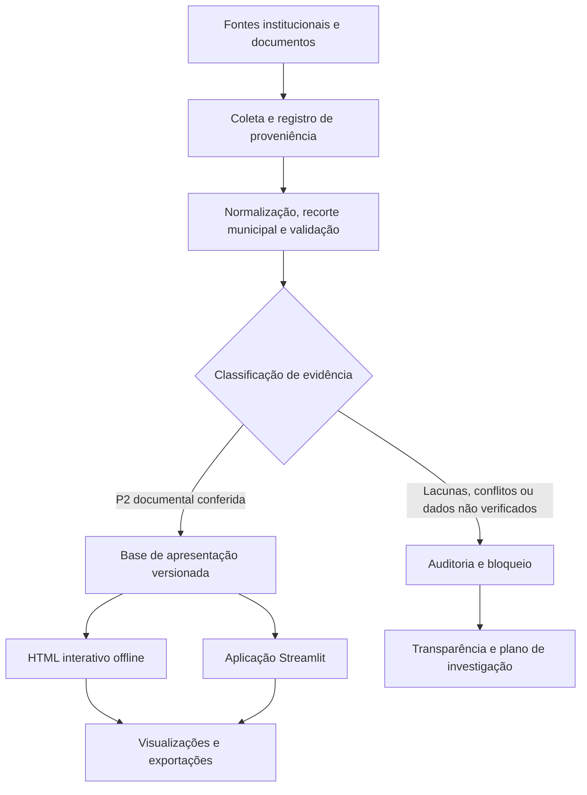

# UDI Market Intelligence

**Observatório Econômico de Uberlândia | Inteligência de mercado, estatística aplicada e governança de dados**

Projeto autoral e independente que organiza informações econômicas de Uberlândia (MG) em uma experiência analítica: indicadores, movimentos empresariais, investigação setorial e transparência metodológica.

O objetivo é transformar informações dispersas em evidências que possam orientar perguntas de negócio, análises de mercado e novas investigações — sem atribuir aos dados conclusões que eles não sustentam.

> **Status:** Beta 1.0 documental — candidato à divulgação, com interface funcional e identidade visual preservada. Não é uma plataforma governamental nem um serviço de atualização em tempo real.

## O observatório em números

| Escopo | Cobertura atual |
|---|---:|
| Grandes mercados catalogados | 12 |
| Subsetores mapeados | 82 |
| Indicadores documentais (P2) | 25 |
| Acontecimentos documentados | 38 |
| Extratos históricos selecionados | 29 |
| Alertas de qualidade | 7 |
| Séries setoriais homologadas (P4) | 0 |

O recorte histórico dos acontecimentos abrange 2022 a setembro de 2026, com atualizações qualitativas posteriores. As competências dos indicadores variam por fonte; emprego formal até setembro e comércio exterior com atualização documental até outubro de 2026.

## Conheça o painel

O observatório possui sete áreas integradas:

- **Visão geral:** indicadores econômicos, gráficos e leituras contextualizadas.
- **Setores e subsetores:** filtros para 82 recortes de investigação e fontes candidatas.
- **Indicadores documentados:** valores com competência, unidade, fonte e natureza da evidência.
- **Movimentos de mercado:** acontecimentos, anúncios, iniciativas e empreendimentos com estágio e origem identificados.
- **Auditoria e limites:** conflitos, lacunas e critérios de validação.
- **Fontes e metodologia:** catálogo institucional e regras de interpretação.
- **Notas de inteligência:** relatórios exploratórios por mercado e exportação de informações.

Este portfólio apresenta a arquitetura, a metodologia e as funcionalidades do observatório. O painel foi desenvolvido como HTML interativo offline; não há hospedagem pública nesta edição. O repositório de desenvolvimento e seu código-fonte permanecem privados.

## Exemplos de leitura econômica

| Evidência documental | Leitura correta |
|---|---|
| 6.619 empresas constituídas em 2025 (JUCEMG) | Constituições anuais sem MEI, não estoque de empresas ativas. |
| 233.965 vínculos formais em setembro de 2026 | Estoque divulgado do Novo Caged; não corresponde necessariamente a pessoas distintas. |
| +611 postos líquidos em setembro de 2026 | Saldo mensal publicado; não equivale à variação direta entre estoques de diferentes edições. |
| US$ 1,214 bilhão exportado, US$ 183,3 milhões importados e US$ 1,030 bilhão de saldo em jan–out/2026 | Agregados obtidos da API oficial Comex Stat em 24/11/2026; saldo calculado em dólares inteiros. Domicílio fiscal do declarante, não necessariamente origem produtiva. |

Fontes: [JUCEMG / Agência Minas](https://www.agenciaminas.mg.gov.br/noticia/minas-gerais-teve-mais-de-114-mil-novas-empresas-abertas-em-2025-128761), [CEPES/IERI/UFU — boletim de setembro](https://www.ieri.ufu.br/acontece/2026-11-boletim-mensal-do-emprego-de-uberlandia-setembro-de-2026), [Comex Stat / MDIC](https://comexstat.mdic.gov.br/pt/municipio), [Prefeitura — comércio exterior](https://www.uberlandia.mg.gov.br/2026/11/10/uberlandia-volta-a-figurar-entre-os-10-municipios-maiores-exportadores-de-minas-gerais/). Nenhuma dessas leituras representa previsão ou recomendação de investimento.

## Arquitetura e tecnologias

| Camada | Tecnologias implementadas |
|---|---|
| Processamento e validação | Python, pandas, NumPy, CSV, SQLite |
| Aplicação analítica | Streamlit, Plotly |
| Interface de apresentação | HTML, CSS, JavaScript, SVG |
| Qualidade e testes | unittest, Node.js, Playwright, GitHub Actions |
| Versionamento e rastreabilidade | Git, registros documentais, hashes SHA-256 |

A interface HTML é autônoma e não consulta fontes ao vivo. A aplicação Streamlit é uma camada separada; ferramentas experimentais e dados sintéticos são restritos ao ambiente de desenvolvimento.

## Metodologia e governança

Cada observação possui município, competência, indicador, unidade, universo, fonte e ressalva. A classificação de evidência evita transformar uma hipótese em dado confirmado.

| Nível | Significado |
|---|---|
| P0 | Simulação para desenvolvimento; não representa a economia real. |
| P1 | Fonte ou recurso identificado. |
| P2 | Valor conferido em publicação institucional ou agregado retornado por consulta oficial; não é série primária homologada. |
| P3 | Arquivo primário obtido, hash registrado e processamento reproduzível. |
| P4 | Série reconciliada, comparável e aprovada após revisão independente. |

O projeto preserva conflitos em vez de interpolar resultados desconhecidos. Cadastros não medem faturamento, anúncios não comprovam execução e ausência de dados não significa zero.

**Fontes de investigação:** IBGE/SIDRA, Novo Caged, RAIS, JUCEMG, Comex Stat/MDIC, CEPES/UFU, Prefeitura de Uberlândia, CNES, Cadastur e ANEEL. Nem toda fonte catalogada possui indicador quantitativo homologado.

## Qualidade e confiabilidade

Em 24/11/2026, o candidato atualizado passou pelos seguintes controles automatizados:

- 141 testes Python aprovados, além de verificações JavaScript/Node e sincronização dos três HTMLs.
- Chrome, Edge e Chromium reais em ambiente automatizado, com desktop e viewport móvel emulada; 21 cenários de responsividade nas sete páginas em 1440, 390 e 320 px sem transbordamento horizontal.
- Sete rotas, filtros, busca, gráfico anual, exportações e conteúdo do CSV verificados.
- Ausência de indicadores quantitativos simulados no HTML de apresentação nos controles executados.
- Hash do HTML registrado, controles de privacidade e rastreabilidade.

A aprovação automatizada não substitui auditoria jurídica, teste físico, avaliação integral de acessibilidade ou homologação estatística.

## Limites e evolução

A versão atual é **documental, não uma série estatística completa**. Saúde, hotelaria e energia solar são pilotos de coleta. O Cadastur teve download e recorte municipal preliminar verificados. A validade e a situação da atividade ainda exigem reconciliação; não se publica contagem de hotéis ativos sem homologação. Não são publicados números setoriais sem evidência suficiente. A API oficial do Comex Stat confirmou os agregados de janeiro a outubro; os valores de agosto permanecem como registro documental arredondado. A extração dos arquivos nacionais e a homologação P4 não foram concluídas.

A evolução concentra-se em coleta primária, harmonização CNAE, comparabilidade temporal, validação independente e análises econômicas orientadas por dados.

## Documentação do portfólio

| Documento | Conteúdo |
|---|---|
| [Arquitetura](docs/arquitetura.md) | Camadas, fluxo de dados, decisões de projeto |
| [Metodologia](docs/metodologia.md) | Recorte, competências, níveis de evidência |
| [Governança e qualidade](docs/governanca-de-dados.md) | Controles, testes, limitações e privacidade |
| [Resultados](docs/resultados.md) | Leituras econômicas, fontes e interpretação |
| [Demonstrações](assets/README.md) | Organização das capturas e vídeos do painel |
| [Histórico de versões](CHANGELOG.md) | Escopo da versão de apresentação |
| [Direitos e atribuições](DIREITOS.md) | Condições dos materiais e fontes |

## Autoria e condições de uso

**Luiz Henrique Marques Costa** — projeto independente de portfólio em inteligência de negócios, Ciência de Dados e estatística aplicada.

O software original está sob a [PolyForm Strict License 1.0.0](https://polyformproject.org/licenses/strict/1.0.0/), que não é uma licença open source. Os dados, marcas e publicações institucionais de terceiros têm condições próprias; a licença do software não concede direitos sobre esses materiais. Os resultados têm caráter exploratório e não constituem aconselhamento financeiro, avaliação de crédito ou recomendação de investimento.

---

*Dados com contexto. Análises com critérios. Inteligência com transparência.*
