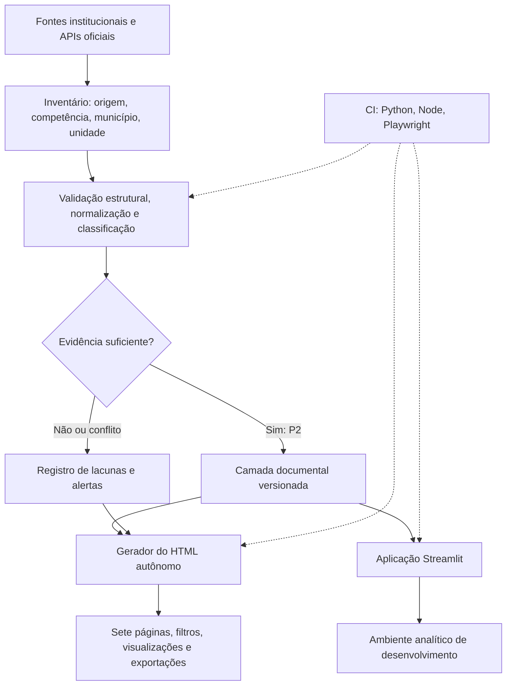

# Arquitetura da solução

[Voltar à apresentação](../README.md)

O UDI Market Intelligence integra um acervo documental de informações econômicas municipais a uma interface de consulta. Não é um sistema de monitoramento em tempo real.

## Camadas implementadas

| Camada | Papel | Tecnologias |
|---|---|---|
| Proveniência | Identificar publicações, URLs, período e recursos candidatos | CSV, JSON, Python |
| Processamento | Conferir esquemas, recorte municipal, duplicidade e consistência | Python, pandas, NumPy |
| Catálogo documental | Organizar indicadores, eventos e taxonomia de mercados | CSV, JSON, SQLite |
| Interface | Navegação, gráficos, buscas, filtros e exportações | HTML, CSS, JavaScript, SVG |
| Desenvolvimento analítico | Ambiente separado de exploração | Streamlit, Plotly |
| Qualidade | Testes de regressão, consistência e comportamento em navegador | unittest, Node, Playwright, GitHub Actions |

## Decisões de projeto

- A versão de apresentação é autônoma: o conjunto documental é incorporado ao HTML, sem consultas externas automáticas.
- A taxonomia representa uma estratégia de investigação por 12 mercados e 82 subsetores, não uma equivalência automática com séries CNAE.
- Dados ausentes ou não conciliados permanecem identificados como lacunas, sem preenchimento artificial.
- O portfólio documenta a arquitetura e contém a interface estática executável no navegador, sem disponibilizar as rotinas de processamento ou as bases brutas.
